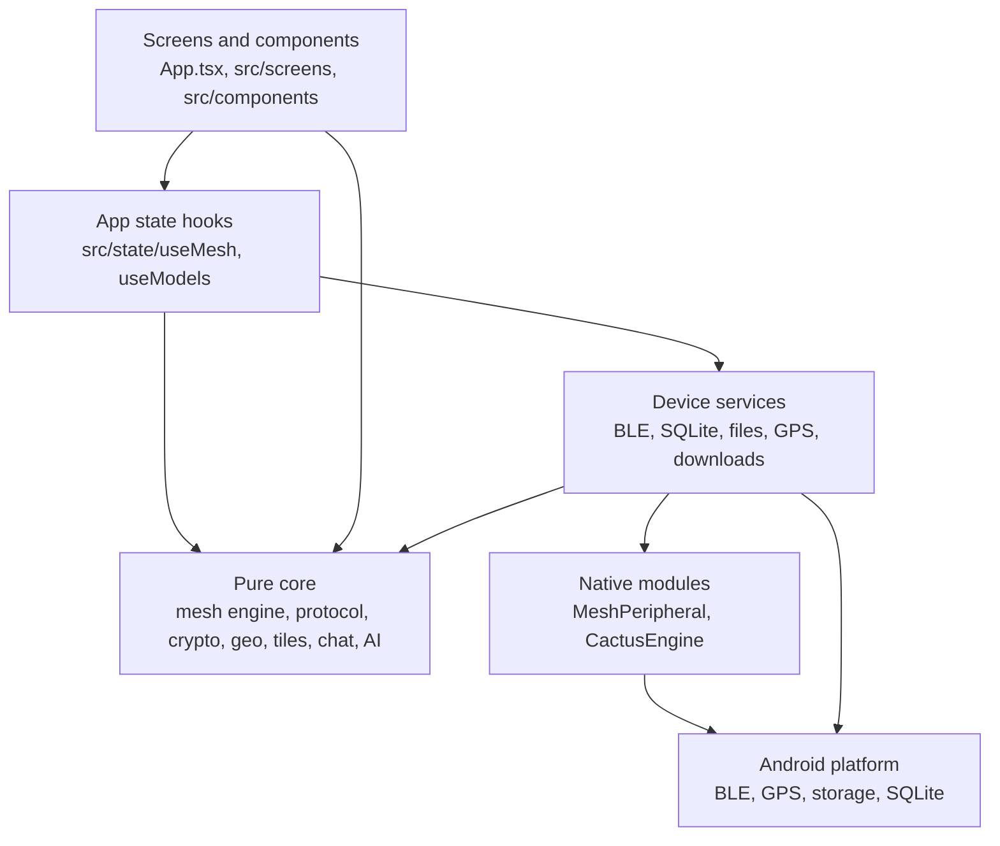
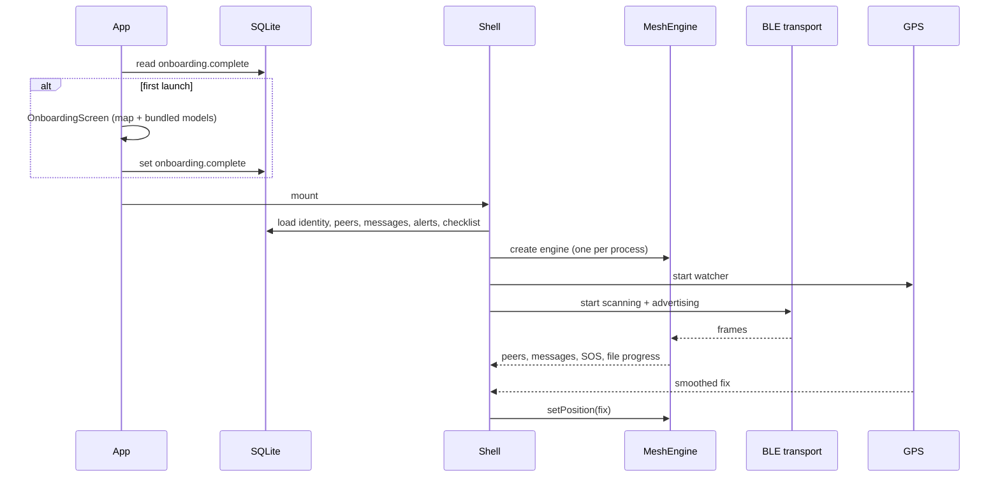

# Architecture

KindMinds Kit is a React Native app with a deliberately small dependency surface
and a hard split between pure decision logic and device I/O. The split exists so
the mesh, map maths, retrieval, and safety checks can be tested in-process; a
disaster app cannot rely on "it worked on my phone once".

## Design principles

1. **Offline is the default, not a fallback.** Map tiles, knowledge records,
   chat history, identity, and models are local files or SQLite rows. Network
   calls happen only when the user starts one (address search, directions, model
   or map download).
2. **One owner per resource.** The app creates exactly one `MeshEngine` and one
   GPS watcher for its lifetime. A second engine would mean a second identity and
   a second radio subscription.
3. **Pure core, thin services.** `src/core/` contains no React Native, file,
   radio, or network imports. `src/services/` owns platform APIs and converts
   their results into core types.
4. **Honest degraded modes.** A missing map pack draws a coordinate grid and
   says so. A central-only BLE stack reports "scanning only". A model that is
   absent, late, or ungrounded returns the approved record with a reason. The UI
   never pretends a capability exists.
5. **Safety is a gate, not a prompt.** The assistant retrieves an approved
   record, lets the model rephrase it, then validates the output against that
   record before display. Crisis language is routed before generation.

## Layers

The arrows matter: core never calls up into services or UI. Screens receive the
mesh API and device snapshot as props and derive everything else during render;
there is no mirrored copy of peers or alerts in component state.

## Module map

| Area | Modules | Responsibility |
| --- | --- | --- |
| App shell | `App.tsx` | onboarding gate, tab strip, permanent SOS action, one mesh + GPS lifetime |
| Screens | `src/screens/*` | Assist, Map, Chat, Kit, Onboarding |
| Components | `src/components/*` | map canvas, search sheet, SOS sheet, model manager, breathing, voice/photo buttons, UI primitives |
| App state | `src/state/useMesh.ts`, `useModels.ts` | engine lifecycle, persistence wiring, location/battery snapshot, installed-model notifications |
| Mesh core | `src/core/mesh/{protocol,engine,crypto,bytes}.ts` | wire format, routing, fragmentation, identity, sealing |
| Mesh transport | `src/services/ble-mesh.ts`, `ble-peripheral.ts` | BLE central + Android GATT server, MTU negotiation, permissions |
| Chat model | `src/core/chat.ts` | rooms, DM timelines, previews, day dividers, proximity ordering |
| Map | `src/core/{geo,tiles,map-pan}.ts`, `src/services/{tile-pack,region-pack,places}.ts`, `src/components/MapCanvas.tsx` | geodesy, MBTiles packs, download/expand, search and routing |
| Knowledge | `src/core/knowledge.ts`, `preparedness.ts` | approved first-aid/wellbeing records, 72-hour kit |
| AI pipeline | `src/core/ai/*` | BM25 retrieval, prompts, local model adapter, validation, safety routing |
| AI runtimes | `src/services/{local-ai,cactus-engine,model-pack,downloads,bundled-models}.ts`, `src/core/ai/{llama,cactus}-backend.ts` | model install/load, llama.rn and Cactus bridges |
| Persistence | `src/services/storage.ts` | SQLite schema and accessors |
| Native | `android/app/src/main/java/org/kindminds/kit/*`, `android/app/src/main/cpp/*` | GATT server, Cactus 4.1 bridge |

## Boot and lifecycle

Boot details:

- `AppRoot` waits for `onboarding.complete`. In a full build it also copies the
  bundled `.cact` models out of the APK once, using
  `models.bundled.installed` as a marker so a deliberate removal is not undone.
- `useMesh` restores the Ed25519/X25519 identity from SQLite before constructing
  the engine, so the peer ID is stable across process restarts. A data wipe or
  reinstall creates a new identity, which is the correct trade-off for an app
  that may run on a borrowed phone.
- The engine announces on boot, on every new link, and on a slow heartbeat.
  Presence is not a button.
- The GPS watcher publishes a smoothed fix into the engine; announcements and
  SOS stamps then carry a real position and accuracy.
- BLE runs only while the app is in the foreground. There is no foreground
  service, so a locked phone stops relaying.

## Feature flags and build variants

`EXPO_PUBLIC_KINDMINDS_LITE=1` selects the lite variant:

- Metro resolves `./model-assets` to `model-assets.lite.ts`, so no `.cact`
  weights are packaged.
- `android/app/build.gradle` sets `kindmindsLite` and excludes the llama/Cactus
  native payload.
- Screens hide or disable AI actions that cannot work.

The full variant bundles Shruti (voice) and Mirage (vision) and allows the larger
text model to be downloaded. Because the Cactus 4.1 archive is arm64-only, the
full AI build is arm64-only; an x86_64 build is for UI and text-model testing.
See [build-and-release.md](build-and-release.md) for the exact switch procedure.

## Data flow examples

**SOS.** `SosSheet` builds a `SosPayload` with a fresh or cached fix, calls
`mesh.sendSos`, and the engine records it locally, emits a `sos` event, and
returns a packet. `useMesh` fragments the packet to the radio's frame budget and
writes it to every link. Receivers dedupe, rank by need, persist, and expose an
"I can help" acknowledgement.

**Room message.** The composer calls `sendBroadcast(text, room)`. The engine
records the message for the sender optimistically, returns a `room` packet, and
the transport broadcasts its frames. Receivers persist and emit `message`.

**Sealed DM.** The engine requires a peer announcement carrying an X25519 public
key. It derives a shared key, seals the UTF-8 text with XChaCha20-Poly1305 using
the packet header as associated data, and addresses the packet to that peer.
Direct packets are never relayed.

**Assistant answer.** `AssistantScreen` calls `localAssist`, which retrieves an
approved record, builds a constrained prompt, runs one bounded completion, and
validates the result. If the model is missing, late, or ungrounded, the caller
receives the record itself plus a fallback reason. The model never supplies
medical facts.

## Adding a feature

- Put decisions and formats in `src/core/` and add a test under `tests/`.
- Put platform I/O in `src/services/`, behind a small typed interface.
- Wire shared lifetime state through `src/state/`, not module-level singletons,
  unless the resource is intentionally process-wide (the BLE manager is).
- Add a degraded path. Ask: what does this screen show with no fix, no pack, no
  radio, no model, or no network?
- Update the relevant document in `docs/` and, for user-visible behaviour, the
  root README.
